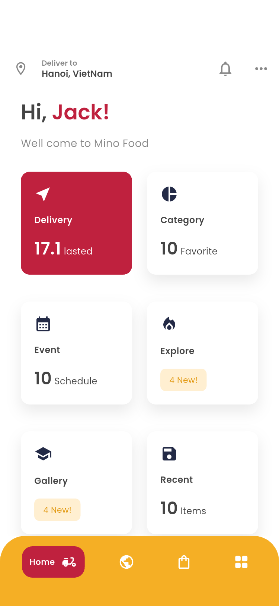
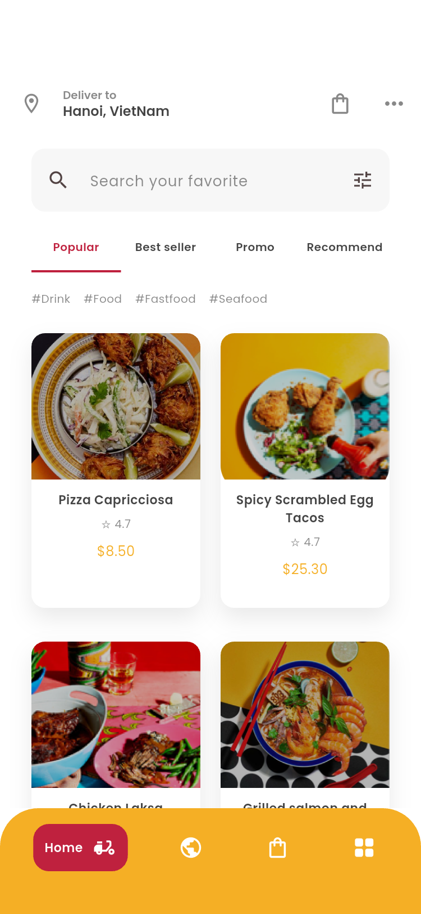
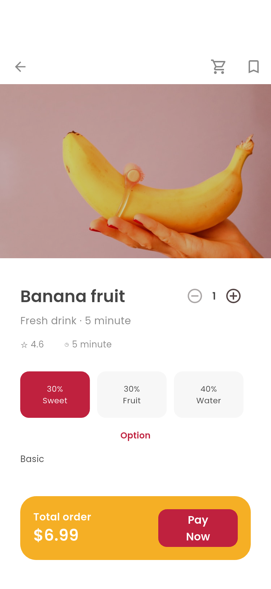
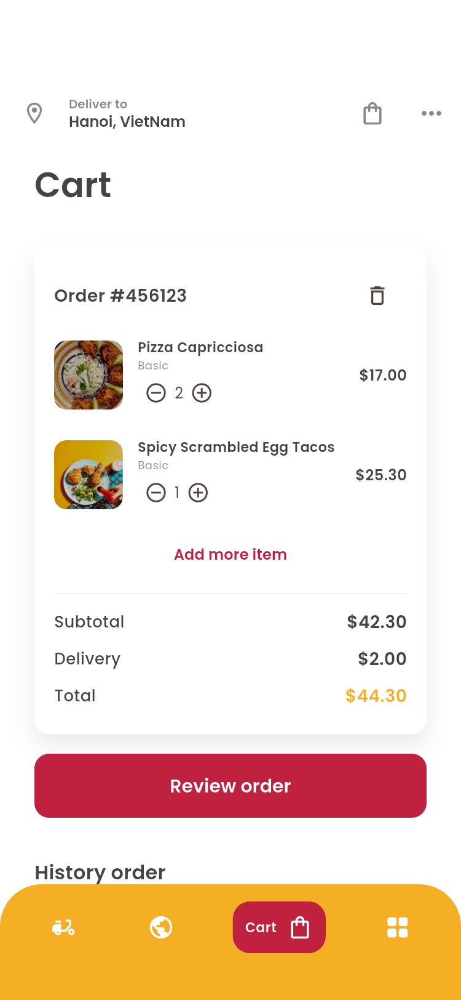
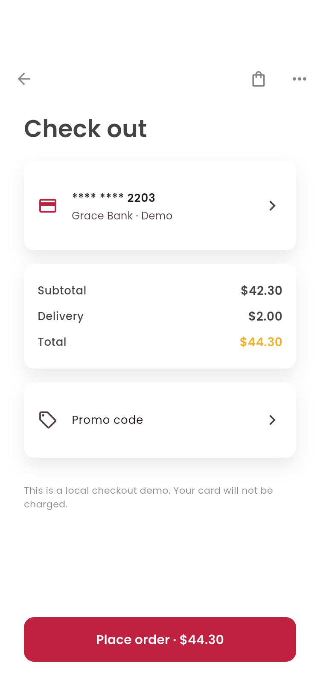
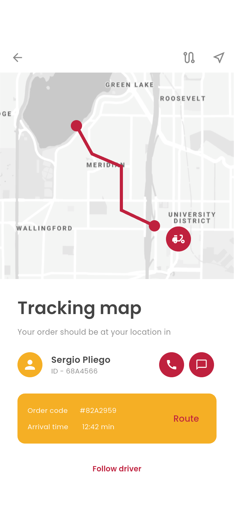
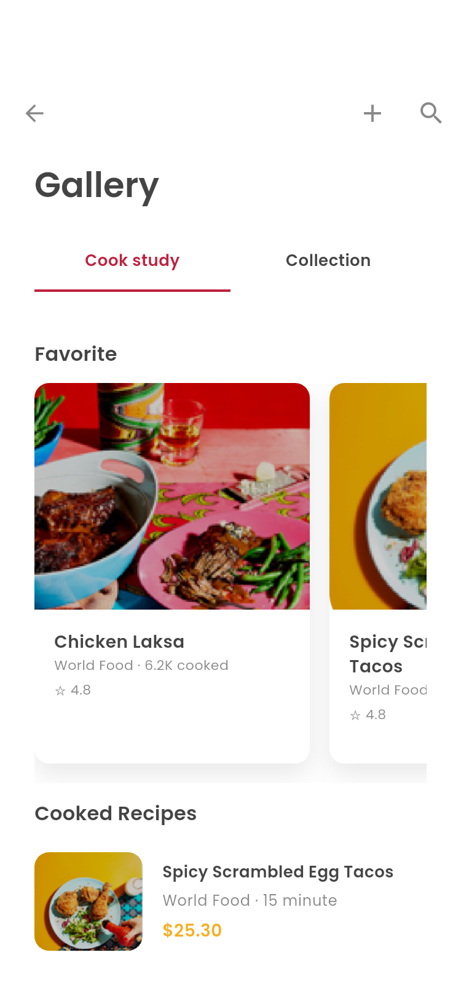
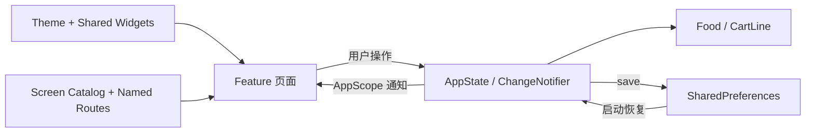

# Eden Food Delivery / Mino Food

根据 Pixso「Eden - Food Delivery App UI Kit」开发的 Flutter 外卖应用 UI。保留设计中的 **Mino Food** 品牌、Poppins 字体、莓红按钮、金黄导航、插画与英文界面。中文文档用于开发和交付说明。

本项目实现 **13 个业务分类、72 个页面及状态**，涵盖引导、登录、首页、位置、预约、搜索、餐厅、商品、结算、购物车、配送、发现和个人中心。Logo、Symbols 两个设计分类作为视觉资源与组件规范使用，不计入业务页面。

## 主要界面

下图为 Android 模拟器运行 Flutter 后获得的截图，不是 Pixso 原稿。

### 首页与点餐







### 购物车、结算与配送







### 食谱发现



完整截图与原稿逐页对照见 [页面索引](docs/SCREENS.md)，资源节点见 [资源说明](docs/ASSETS.md)，验证环境见 [验证记录](docs/VALIDATION.md)。

## 启动

环境：Flutter 3.47.7、Dart 3.13.5。依赖版本锁定在 `pubspec.lock`。

安装体验：[Android APK](dist/MinoFood.apk)（通用架构、开发签名）。

```powershell
flutter pub get
flutter run -d emulator-5554
```

没有正在运行的模拟器时，先执行 `flutter emulators`，再使用 `flutter emulators --launch <模拟器名称>` 启动。

Web 预览：

```powershell
flutter run -d chrome
```

首次启动显示欢迎及引导页；可选择「Explore Mino Food」直接体验，也可使用手机号登录流程。再次启动会恢复已保存的登录状态与数据。

## 体验路径

1. **引导 → 登录 → 验证码 → 通知 → 地址 → 首页**。验证码为 `2418`，手机号至少 7 位，密码至少 6 位。登录为本地演示，不发送短信。
2. **Delivery → 菜品列表 → 商品 → 详情与加料 → 加入购物车**。数量、不同加料组合、收藏即时更新。
3. **购物车 → Review order → Checkout → 配送地址 → 支付方式 → 订单确认 → 下单成功**。
4. 没有卡片时可添加演示卡：任意 16 位数字、有效格式 `MM/YY`、3–4 位 CVV。只保存卡尾四位，不保存卡号与 CVV，不发起扣款。
5. **Personal Offer → 输入 `MINO15` → 应用优惠 → 结算**。演示优惠按菜品小计减 15%，配送费为 $2.00。
6. **下单成功 → 查找司机 → 地图 → 路线/跟随 → 确认收货 → 星级评价**。
7. **Event → 预约列表 → 新建预约 → 选择日期时间 → 成功 → 详情**。
8. **Gallery / Connect → 食谱 → 食材/步骤 → 收藏与预览**。
9. **Menu → 个人资料 / 会员 / 设置**。调试版本在 Settings 中提供「Page collection」供逐页验收；发行版本隐藏此入口。

页面顶部的「更多」可进入预约、分类、图库、优惠和设置。底部导航为 Home、Connect、Cart、Menu。

## 项目结构

```text
lib/
├── main.dart                     # 初始化本地存储、系统栏及应用
├── app.dart                      # 应用入口、命名路由和平台宽度约束
├── core/
│   ├── app_state.dart             # 会话、购物车、订单、设置及持久化
│   ├── theme.dart                 # 颜色、字体、按钮和输入框规范
│   └── screen_catalog.dart        # 72 个设计节点与路由的映射
├── domain/
│   └── models.dart                # Food、CartLine 与整数分金额格式化
├── shared/
│   └── widgets.dart               # 页面骨架、导航、卡片、表单与结果弹层
└── features/
    ├── auth/                     # 欢迎、三页引导、登录注册、验证码、通知
    ├── home/                     # 首页六宫格
    ├── location/                 # 地址表单、地图选择
    ├── schedule/                 # 预约创建、列表、详情与成功状态
    ├── catalog/                  # 搜索筛选、分类、商品、加料、评价
    ├── restaurant/               # 餐厅、反馈、聊天与通话预览
    ├── orders/                   # 购物车、优惠、账单、二维码与结算
    ├── delivery/                 # 司机、地图、路线、收货及评价
    ├── discover/                 # 社区、收藏、食谱及幻灯预览
    └── profile/                  # 资料、会员、菜单、设置

assets/
├── fonts/                        # Poppins 四字重与 OFL 字体许可
└── images/                       # 从 Pixso 节点导出的本地插画和图片
test/                             # 状态、持久化、全页面布局及交互测试
integration_test/                 # Android 截图和下单完整流程
test_driver/                      # 将模拟器截图保存到本机
docs/
├── SCREENS.md                    # 所有页面、设计节点和截图索引
├── design-index.json             # Pixso 文件分类及节点信息
├── reference/                    # 72 张设计原稿导出图
└── screenshots/                  # 72 张 Flutter 模拟器截图
android/ ios/ web/                # Flutter 平台工程
```

## 架构与数据流

采用按业务模块划分的轻量结构。界面复用 `PageShell`、`Surface`、`FoodRow`、`Outcome` 等组件；相近状态共用页面实现，通过 `mode` 显示差异，避免为 72 张设计稿复制 72 套代码。



`AppScope` 基于 Flutter 自带 `InheritedNotifier` 向页面提供状态，不引入额外状态管理框架。跨模块状态集中在 `AppState`；输入框、筛选选择、聊天草稿、播放进度等短期状态保留在页面中，控制器与定时器随页面释放。

金额使用整数「分」计算，避免浮点累计误差。相同菜品和加料组合合并数量；不同加料生成独立购物车行。下单时保存订单快照，再清空购物车；账单使用订单快照。二维码编码订单编号、地址及金额，是可扫描的本地演示数据。

持久化内容：购物车、收藏、个人资料、地址、卡尾号、登录/引导状态、预约名称、通知及订阅设置、最近订单快照。示例目录菜品位于 `domain/models.dart`，不依赖网络即可浏览。

## 设计还原与资源

设计来源：当前连接的 Pixso 文件「Eden - Food Delivery App UI Kit」，包含 15 个页面分类。已逐类读取全部 72 个业务画板，原始节点保存在 `docs/design-index.json`。

| 规范 | 实现 |
| --- | --- |
| 基准画板 | 375 × 812 |
| 主要字体 | Poppins Regular / Medium / SemiBold / Bold |
| 主按钮 | 莓红 `#BF213E`，52 高，12 圆角 |
| 导航与强调 | 金黄 `#F5AF25` |
| 文字 | `#444444` / `#888888` |
| 页面边距 | 常用 28，内容可纵向滚动 |
| 辅助颜色 | 青色、浅灰及原稿深色弹层遮罩 |

原稿部分图片存在缺失或灰色占位。本项目复用同一文件中可导出的食物图片补全这些区域，未将整张原稿当作 App 背景。界面由真实 Flutter 文本、按钮、表单和列表构成。部分原稿英文拼写作了可读性修正。

插画、地图及食物图片从 Pixso 指定节点导出，用于此次参考实现；其使用权以原设计资源授权为准。Poppins 字体许可见 `assets/fonts/OFL.txt`。

## 测试与截图复现

```powershell
flutter analyze
flutter test --reporter expanded
flutter drive --no-pub --driver=test_driver/screenshots_driver.dart --target=integration_test/screenshots_test.dart -d emulator-5554
flutter build apk --release
```

测试覆盖购物车合并、加料价格、优惠计算、下单清空、存储恢复、72 路由在 375 × 812 和 320 × 740 两档布局、实际点击点餐流程；Android 集成测试额外完成付款确认至配送地图，并保存每个页面截图。截图使用固定的本地演示数据，方便复现，不会改写正常运行的用户数据。

截图使用 Flutter 官方 `integration_test` 在 Android 模拟器运行应用，等待页面布局与动画结束，并预加载本地图片后，通过当前 Flutter 图层生成 PNG。这样可以避免 Android 表面缓冲在快速切页时返回上一帧。参见 [Flutter 图层截图 API](https://api.flutter.dev/flutter/rendering/RenderRepaintBoundary/toImage.html)。

## 当前边界与后续接入

当前交付为**可操作、可离线运行的完整 UI 演示**。手机号登录、短信、Facebook、会员购买、扣款、系统通知授权、GPS 定位、司机轨迹和对外通话未接入真实服务。地图使用原稿静态底图；聊天仅保存当前会话中输入的消息；视频页为本地食谱幻灯预览；发票支持复制内容后自行发送。

预约表单可选日期、时间和参与者，目前仅预约名称持久化，详情使用原稿示例内容。历史订单演示以最近一次订单快照为主，未实现服务端多订单列表。邮箱等资料可本地编辑，但不会同步服务端。筛选基于有限的本地目录数据。

后续可在 `AppState` 与数据模型之间引入 repository/service 层，接入账号、菜品、订单、地图、支付与消息接口，再将演示状态替换为真实数据。此版本没有为了未来服务提前引入复杂依赖。

Android 在本机模拟器验证。已生成 iOS 与 Web 平台工程；Windows 环境无法构建或验证 iOS。交付 APK 使用开发签名，正式上架前需配置自己的签名与服务。
